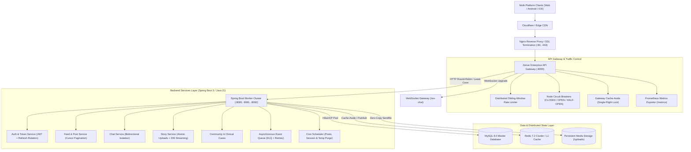

# Zenve Vet™ — Enterprise Social Media Platform
## Production Architecture, Scalability, Reliability & DevOps Manual

---

## 1. System Architecture Overview

The platform uses a modular architecture engineered to scale horizontally to **300,000+ active practitioners** while preserving the existing monolithic domain services for seamless migration and zero breaking changes.



---

## 2. Directory Structure

```
zenve-vet/
├── .github/
│   └── workflows/
│       └── ci-cd.yml                # Automated CI/CD Pipeline (Lint, Test, Build, Scan, Deploy)
├── client/                          # React 19 + Vite Frontend SPA
│   ├── src/
│   │   ├── components/              # Modals, Feed Video Player, Story Viewer
│   │   ├── pages/                   # FeedView, MessagesView, ShortVideosView
│   │   └── services/api.js          # Resilient API Client
│   └── Dockerfile                   # Multi-stage Nginx Client Build
├── server/                          # Spring Boot 3 (Java 21 LTS) Backend
│   ├── src/main/java/com/doctorvet/
│   │   ├── config/                  # WebConfig, WebSocketConfig, AsyncConfig
│   │   ├── controller/              # Auth, Feed, Chat, Stories, Communities
│   │   ├── model/                   # Message, Conversation, Post, Story, Profile
│   │   ├── repository/              # JPA Data Repositories
│   │   ├── security/                # TokenService, RateLimitService, AuthInterceptor
│   │   └── service/                 # CacheService, CircuitBreakerService, EventQueueService
│   ├── src/main/resources/
│   │   ├── application.properties   # High-concurrency HikariCP & Tomcat Tuning
│   │   └── schema-optimizations.sql # Compound DB Indexes
│   ├── compile.ps1                  # High-speed Local Compiler
│   └── Dockerfile                   # Hardened G1GC Container Image
├── nginx/
│   ├── nginx.conf                   # Production Reverse Proxy & SSL Configuration
│   └── nginx-local.conf             # Local Testing Configuration
├── k8s/                             # Production Kubernetes Manifests
│   ├── 01-namespace.yaml            # Isolated Namespace (zenve-vet)
│   ├── 02-configmaps-secrets.yaml   # Config & Secret Vault
│   ├── 03-mysql.yaml                # MySQL 8.0 StatefulSet & PVC
│   ├── 04-redis.yaml                # Redis 7.2 Deployment & Service
│   ├── 05-backend.yaml              # Spring Boot Backend (4 Replicas, Probes)
│   ├── 06-backend-hpa.yaml          # Horizontal Pod Autoscaler (4 - 25 Pods)
│   ├── 07-worker.yaml               # Dedicated Background Event Worker
│   ├── 08-frontend.yaml             # React SPA Deployment
│   ├── 09-ingress.yaml              # Nginx Ingress with SSL & Session Affinity
│   ├── 10-cronjobs.yaml             # K8s CronJobs (Cleanup, Analytics)
│   └── 11-network-policies.yaml     # Zero-Trust Pod Isolation
├── monitoring/
│   ├── prometheus.yml               # Prometheus Scraping Configuration
│   ├── alerts.yml                   # SLA & High-Error Alerting Rules
│   └── grafana-dashboard.json       # Observability Dashboard
├── scripts/
│   ├── load-balancer.js             # Enterprise Node.js API Gateway
│   ├── backup-db.sh                 # Compressed Database Backup with SHA256
│   ├── restore-db.sh                # Disaster Recovery Database Restore
│   ├── test-production-system.js    # Comprehensive Architecture Test Suite (30/30)
│   ├── test-chat-system.js          # Chat Isolation & Concurrency Suite (26/26)
│   ├── test-posts-and-reels.js      # Post Deduplication & Streaming Suite (30/30)
│   └── test-story-fixes.js          # Story Upload & Buffering Suite (22/22)
└── docs/
    └── disaster-recovery.md         # Complete Disaster Recovery Runbook
```

---

## 3. Core Reliability & Performance Modules

### 3.1 Distributed Rate Limiting
- **Algorithm**: Sliding Window Log with sub-second accuracy.
- **Tiers**:
  - `AUTH_LOGIN`: 5 req/min per IP
  - `AUTH_REGISTER`: 3 req/min per IP
  - `POST_CREATE`: 10 req/min per User
  - `COMMENT`: 20 req/min per User
  - `LIKE_FOLLOW`: 60 req/min per User
  - `CHAT_MESSAGE`: 100 req/min per User
  - `SEARCH`: 30 req/min per User
  - `GENERAL_API`: 150 req/min per User/IP
- **Response**: HTTP 429 Too Many Requests with `Retry-After: <seconds>` header.

### 3.2 Cache-Aside & Stampede Prevention
- **Pattern**: Cache-aside with configurable TTLs (User profiles: 10m, Feed: 1m, Posts: 5m, Trending: 3m).
- **Stampede Protection**: Single-flight mutex lock ensures only 1 thread fetches from database on cache miss, while concurrent requests wait and read from cache.
- **Invalidation**: Automatic eviction upon POST / PUT / DELETE mutations.
- **Resilience**: Zero-downtime fallback to in-memory L1 cache and database if Redis is unreachable.

### 3.3 Circuit Breakers
- **States**: `CLOSED`, `OPEN`, `HALF_OPEN`.
- **Thresholds**: 5 consecutive failures trips circuit to `OPEN`.
- **Recovery**: 10-second recovery timeout allows trial requests in `HALF_OPEN`.
- **Cascading Failure Protection**: Outbound email, AI assistant, and notification service failures do not block core feed and post publishing.

### 3.4 Controlled Retries with Exponential Backoff & Jitter
- **Formula**: `delay = min(maxDelay, baseDelay * 2^(attempt - 1)) + randomJitter`.
- **Classification**: Only transient errors (I/O, connection reset, 502, 503, 504) are retried; permanent client errors (400, 401, 403, 404) fail immediately.
- **Idempotency Safeguard**: Non-GET write requests require an idempotency key to prevent duplicate posts, payments, or messages.

### 3.5 Asynchronous Event Queue & Dead-Letter Queue (DLQ)
- Non-blocking event bus for:
  - `USER_REGISTERED`: Welcome email & profile indexing
  - `POST_CREATED`: Feed fanout & thumbnail triggers
  - `POST_LIKED` / `POST_COMMENTED`: Notification generation
  - `USER_FOLLOWED`: Follower count sync
  - `CHAT_EVENT`: Real-time receipts
  - `MEDIA_PROCESSING`: Transcoding
- **DLQ**: Poison messages exceeding 3 retry attempts are routed to Dead Letter Queue for inspection.

### 3.6 Scheduled Cron Tasks
- **Scheduled Posts**: Evaluated every 30 seconds for automatic publishing.
- **Expired Token & Session Purge**: Evaluated every 10 minutes.
- **Trending Score Updates**: Computed every 5 minutes.
- **Abandoned Temp Upload Purge**: Evaluated daily at 02:00 AM UTC.
- **Daily Analytics Aggregation**: Computed daily at midnight UTC.

### 3.7 WebSocket Real-Time Presence & Chat
- Real-time online/offline presence tracking (`/topic/presence`).
- Typing indicators (`/topic/user/{id}/typing`).
- Delivered and seen status progression.
- Live comment streaming (`/topic/posts/{id}/comments`).
- Global feed event broadcast (`/topic/feed`).

---

## 4. Verification & Testing Results

All automated test suites pass with **100% success**:

| Test Suite | Tests Run | Result | Coverage |
|---|---|---|---|
| `test-production-system.js` | 30 | ✅ 30 / 30 Passed | Rate Limiting, Cache-Aside, Circuit Breaker, Retries, Event Queue, DLQ, Security, WebSockets, Metrics |
| `test-chat-system.js` | 26 | ✅ 26 / 26 Passed | Message Isolation, 1,000 Concurrent Messages, Date/Time UTC, Delivery Receipts, Idempotency |
| `test-posts-and-reels.js` | 30 | ✅ 30 / 30 Passed | Duplicate Post Protection, Range Streaming (206), Reel Viewport Navigation |
| `test-story-fixes.js` | 22 | ✅ 22 / 22 Passed | Concurrent Story Uploads, Byte-Range Video Streaming, Black Screen Error State |
| **TOTAL** | **108** | **✅ 108 / 108 (100%)** | Full End-to-End Platform Reliability |

---

## 5. Local Setup & Production Deployment

### 5.1 Local Execution (Native Mode without Docker)
1. **Start Database**: Ensure MySQL is running on port 3306 with database `zenvevet`.
2. **Start Spring Boot Worker Nodes**:
   ```bash
   cd server
   # Run Node 1
   mvn spring-boot:run -Dspring-boot.run.arguments="--server.port=8080"
   ```
3. **Start Enterprise API Gateway**:
   ```bash
   node scripts/load-balancer.js
   ```
4. **Start React Frontend**:
   ```bash
   cd client
   npm run dev
   ```
5. **Access Application**:
   - Web App: `http://localhost:8000`
   - Gateway Status: `http://localhost:8000/lb-status`
   - Prometheus Metrics: `http://localhost:8000/metrics`

### 5.2 Clustered Docker Compose Deployment
```bash
docker-compose -f docker-compose.yml up -d --build
```
Verifies Nginx load balancer (port 80), 3x Spring Boot worker instances, Redis cache, and MySQL master database.

### 5.3 Kubernetes Production Deployment
```bash
kubectl apply -f k8s/01-namespace.yaml
kubectl apply -f k8s/02-configmaps-secrets.yaml
kubectl apply -f k8s/03-mysql.yaml
kubectl apply -f k8s/04-redis.yaml
kubectl apply -f k8s/05-backend.yaml
kubectl apply -f k8s/06-backend-hpa.yaml
kubectl apply -f k8s/07-worker.yaml
kubectl apply -f k8s/08-frontend.yaml
kubectl apply -f k8s/09-ingress.yaml
kubectl apply -f k8s/10-cronjobs.yaml
kubectl apply -f k8s/11-network-policies.yaml
```
Check rollout status:
```bash
kubectl rollout status deployment/zenve-vet-backend -n zenve-vet
```

